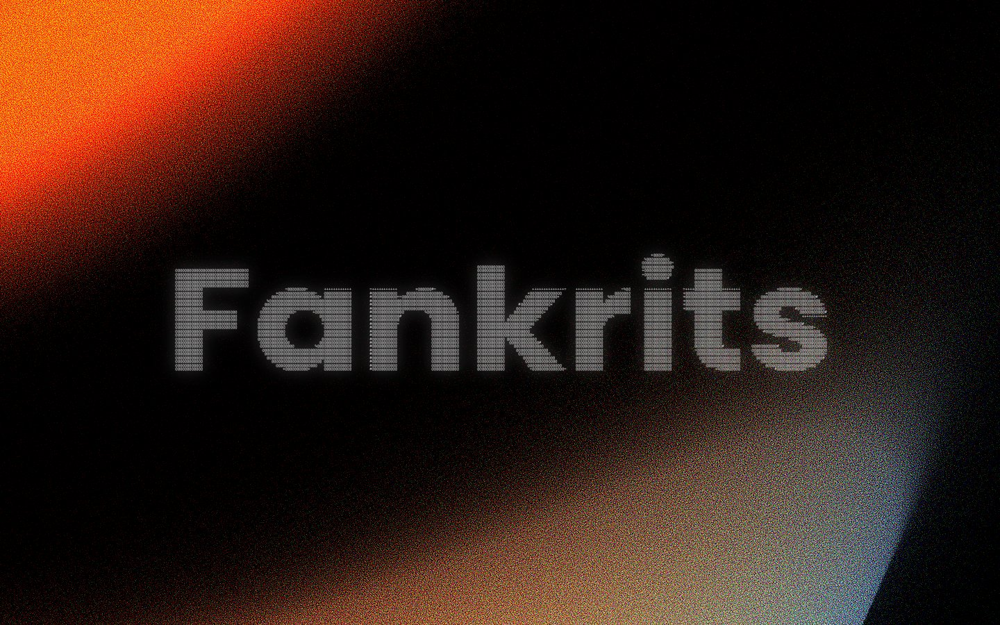
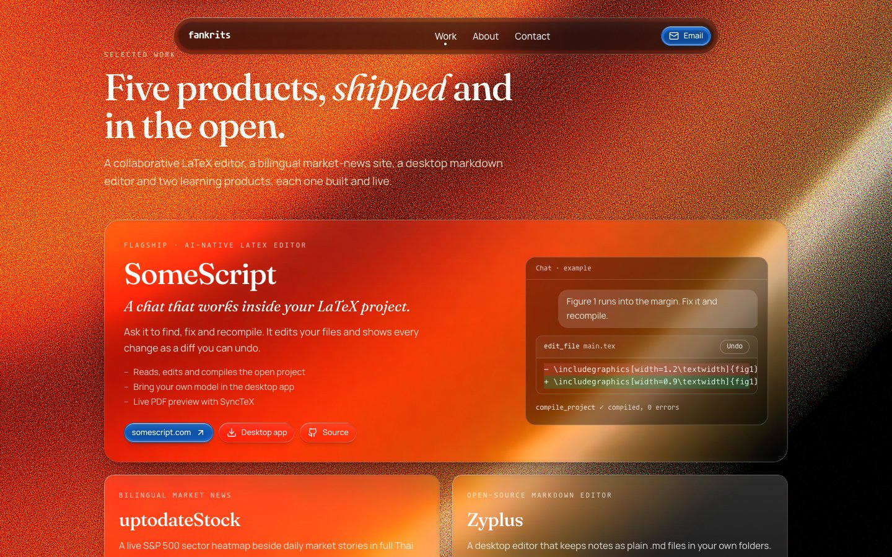
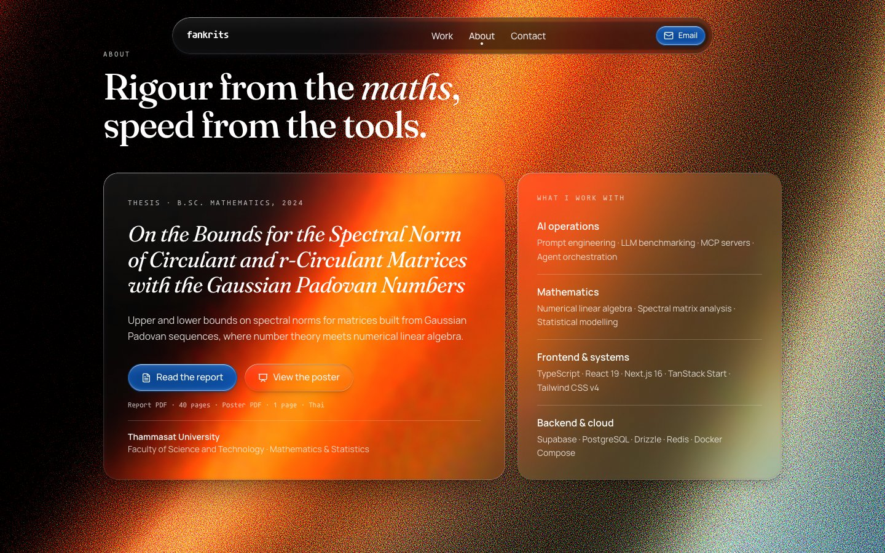

<div align="center">

# fankrits

**Portfolio of Kritsada Nhanjeing, a mathematician who builds AI agents, MCP servers and the products around them.**

A scroll-driven ASCII hero over a live WebGL gradient, then a set of liquid-glass sections.

[**fankrits.com**](https://fankrits.com) · [Email](mailto:contact@fankrits.com) · [GitHub](https://github.com/Fankrits)




</div>

---

## What's on the page

| Section     | What it shows                                                                                                              |
| :---------- | :------------------------------------------------------------------------------------------------------------------------- |
| **Hero**    | The name in ASCII art that dissolves character by character as you scroll, over a fixed Three.js shader gradient.          |
| **Work**    | SomeScript as the flagship, with a small animated example of its AI chat, then uptodateStock, Zyplus, SomeMath and Memize. |
| **About**   | The research behind the maths degree, with the report and poster as PDFs, and a short list of what I work with.            |
| **Contact** | Email and GitHub.                                                                                                          |

<table>
  <tr>
    <td width="50%"></td>
    <td width="50%"></td>
  </tr>
</table>

A floating glass navbar appears once the hero has dissolved and marks the section you are in.

## How it is built

| Layer      | Choice                                                                                               |
| :--------- | :--------------------------------------------------------------------------------------------------- |
| Framework  | [TanStack Start](https://tanstack.com/start) with React 19, server-rendered, deployed through Nitro  |
| Toolchain  | [Vite+](https://viteplus.dev) (`vp`), Bun, the React Compiler                                        |
| Styling    | Tailwind CSS v4, [Glassy UI](https://glassyui.com) components copied into `src/components/glassyui`  |
| Background | [`@shadergradient/react`](https://github.com/ruucm/shadergradient) on Three.js and react-three-fiber |
| Type       | Fraunces (headlines), Manrope (body), Agave Nerd Font (labels, subset to 12 KB woff2)                |

## Performance

The WebGL background used to dominate load time. What changed:

- **Separate chunk for WebGL.** Three.js, react-three-fiber and the shader load lazily, so the page hydrates from a 387 KB (122 KB gzip) bundle instead of 1.5 MB. A static gradient in the same palette shows until the shader is ready.
- **Self-hosted lighting maps.** The shader library fetched three 1.5 MB HDR files from GitHub Pages one after another and used only one. `public/hdr/` now serves the one it uses (downsampled to 512×256) and two 4-pixel stand-ins: about 0.25 MB instead of 4.5 MB.
- **Deferred glass lenses.** Glassy UI builds each Chromium edge-lens map on the CPU at mount. `deferred-glass.tsx` turns the lens on per element when it is near the viewport and the browser is idle.
- **Fonts without a render-blocking chain.** Google Fonts through `preconnect` and a `<link>`, Agave self-hosted.
- **Compressed static assets** through `compressPublicAssets`.

On a throttled connection (1.5 Mbps, 4× slower CPU) the lighting maps finished at 3.7 s instead of 31.7 s, and first paint moved from about 2.7 s to 1.5 s.

## SEO and GEO

- Title, description, canonical, Open Graph and Twitter tags, built from `src/lib/seo.ts`.
- JSON-LD graph: `WebSite`, `ProfilePage`, `Person` and one node per product.
- `public/sitemap.xml`, `public/robots.txt` (with explicit AI-crawler rules), `public/llms.txt` and `public/llms-full.txt`.
- A screen-reader-only `<h1>` and summary, because the hero is art.
- Favicon set and a generated 1200×630 social card.

## Project structure

```
src/
├── routes/
│   ├── __root.tsx          # document shell, head tags, JSON-LD
│   └── index.tsx           # hero scroll logic, background, page sections
├── components/
│   ├── landing/            # site-header, work/about/contact sections, chat demo
│   ├── glassyui/           # Glassy UI source (registry files, unmodified)
│   └── terminal-demo/      # earlier terminal UI, kept but not mounted
├── lib/seo.ts              # site constants and structured data
└── asciiArt.ts             # the hero art
public/
├── hdr/ fonts/ thesis/     # self-hosted lighting maps, fonts, research PDFs
└── sitemap.xml robots.txt llms.txt og.png
```

## Run it

Requires [Bun](https://bun.sh) 1.3 and the Vite+ CLI.

```sh
bun install
bun run dev          # http://localhost:3005
bun run build        # production build into .output/
```

Preview the production build (the server output needs Bun, not Node):

```sh
PORT=4173 bun .output/server/index.mjs
```

## Notes

- Glassy UI is installed by copying its registry source (`https://glassyui.com/r/<component>.json`), because the shadcn CLI refuses this repo's `devEngines` bun setting. The theme is `data-lg-theme="dark"` on `<html>`.
- Headless browsers render WebGL in software, so the shader's real cost depends on the visitor's GPU.

## Contact

- Website: [fankrits.com](https://fankrits.com)
- Email: [contact@fankrits.com](mailto:contact@fankrits.com)
- Instagram: [@fankrits](https://instagram.com/fankrits)
- GitHub: [@Fankrits](https://github.com/Fankrits)
